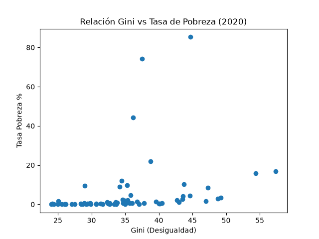

# Pipeline ETL de Pobreza y Desigualdad - Banco Mundial

Pipeline ETL completo que extrae, limpia y analiza 5 indicadores del Banco Mundial (2020-2023).

## Stack
Python, Pandas, Matplotlib

## Proceso ETL
1. **Extract:** 5 CSVs crudos del Banco Mundial con 4 filas de metadata basura
2. **Transform:** `skiprows=4`, filtro 2020-2023, `melt()` para pasar años de columnas a filas, `dropna()`, `merge()` con outer join
3. **Load:** Tabla maestra unificada `master_poverty_data.csv`

## Hallazgos (2020)
- País más desigual: Kosovo (Gini 57.4, pobreza 16.8%)
- Outlier extremo: Congo Dem. Rep. (Gini 44.7, pobreza 85.3%)
- Insight clave: Alta desigualdad no implica alta pobreza (ej: Costa Rica Gini 49.2 pero solo 3.4% pobreza)
- Colombia 2do más desigual (54.4) con 15.8% de pobreza

## Cómo correr
```bash
python main.py
python analisis.py